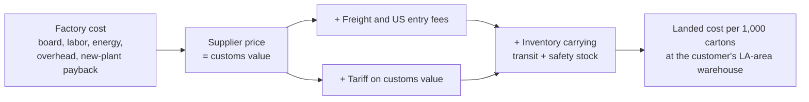

# China, Vietnam or Mexico? A Tariff-Era Sourcing Decision

**English** · [中文](README.zh-CN.md) · [Interactive explorer](https://hql7-luo.github.io/tariff-sourcing-decision/) · [One-page decision memo](docs/memo.md)

A Zhejiang folding-carton maker ships 60 million printed retail boxes a year to a US customer. In October 2026 the US tariff on Chinese cartons is 37.5%, on Vietnamese cartons 12.5%, and USMCA-qualifying Mexican cartons enter duty-free. Should the company keep producing in China, or move its US production?

This project answers that with a landed-cost model built on current public data (tariffs, freight, exchange rates, paperboard prices, wages), four tariff scenarios and a 10,000-run simulation.

## The answer

**Stay in China for now. Spend about $300K to keep a Vietnam option ready, and move if China's tariff climbs to about 35 points above Vietnam's.**

| 5-year average landed cost, per 1,000 cartons | China | Vietnam | Mexico |
|---|---:|---:|---:|
| At today's tariffs | **$201.7** | $213.9 | $238.5 |
| Gap vs. China | | +$12.2 (+6%) | +$36.7 (+18%) |

- **Vietnam's tariff advantage is real but not yet big enough.** Its lower tariff saves about $24 per 1,000 cartons, but a new plant costs about $21 per 1,000 to pay back over 5 years, plus new-site overhead.
- **The trigger is a China tariff near 48%** (with Vietnam at 12.5%). The pending Section 301 "overcapacity" case could get there: in that scenario Vietnam is already slightly cheaper ($228.6 vs. $230.0).
- **Mexico loses on paperboard, not wages.** North American board costs about 2.3 times China's, and since July 2026 Mexico charges an antidumping duty of up to $0.49/kg on Chinese board. Mexico would need delivered board near $910/t (about $1,250/t today) to match China.
- **Under uncertainty, waiting with a ready option is the safer bet.** Across 10,000 simulated futures China is cheapest 78% of the time and Vietnam 21%. Keeping Vietnam ready costs 0.3% more on average and cuts the bad-case cost of being wrong from $4.4 to $2.8 per 1,000.


## Key charts

**Where the cost comes from.** China pays the largest tariff bill; new sites pay for a new plant; Mexico pays more than twice as much for paperboard.


**Strategies under uncertainty.** Tariff scenario, freight, board price, exchange rate, productivity and plant cost all vary in each run.


**What changes the answer.** Tariffs and the plant payback period matter most; wages and freight matter far less, because China and Vietnam both ship by ocean.


## How the model works



- **Four strategies:** stay in China; move to Vietnam now; move to Mexico now; stay in China and keep Vietnam ready (decide in year 2 once the tariff path is known).
- **Five-year horizon** with a 10% discount rate. New sites have a weaker first year (lower output per hour, more scrap) and must recover a $5M line plus $1M startup cost.
- **Four tariff scenarios** with judgment-based probabilities: status quo (40%), relief (20%), overcapacity tariffs (30%), USMCA friction (10%).
- **Monte Carlo:** 10,000 runs varying eight uncertain inputs with triangular distributions.

Full details: [methodology](docs/methodology.md).

## Data

Every input lives in [`data/inputs.csv`](data/inputs.csv) with its unit, source, date, and a flag for **sourced** vs. **assumption**. The main sourced values:

| Input | Value | Source (date) |
|---|---|---|
| US tariff, Chinese folding cartons (HTS 4819.20) | 37.5% | Section 301 List 3 25% + forced-labor Section 301 12.5% (Jul 2026) |
| US tariff, Vietnamese cartons | 12.5% | Forced-labor Section 301 (Jul 2026) |
| US tariff, Mexican cartons | 0% if USMCA-qualifying | USMCA exemption (Jul 2026) |
| Ocean freight, Shanghai to Los Angeles | $7,884 per 40ft | Drewry WCI (Oct 15, 2026) |
| China white cardboard | ¥4,040/t incl. VAT | SunSirs benchmark (Oct 8, 2026) |
| US folding boxboard | $1,178/t | PackIndex benchmark (Jul 2026) |
| Mexico antidumping duty on Chinese board | $0.4854/kg | Diario Oficial de la Federación (Jul 9, 2026) |
| Exchange rates | ¥6.69, ₫25,639, MX$18.50 per USD | Federal Reserve H.10, State Bank of Vietnam (Oct 2026) |
| Wages | China ¥76,055/yr; Vietnam ₫10.0M/month; Mexico $5.50/hr loaded | NBS 2025; Vietnam NSO Q1 2026; border-zone benchmark 2026 |

All sources with links: [docs/data-sources.md](docs/data-sources.md).

## Run it

```bash
pip install -r requirements.txt
python run_analysis.py   # writes results/, figures/ and the explorer data
pytest                   # model checks, including Python vs. JavaScript parity
```

To try your own assumptions, edit `data/inputs.csv` or `data/tariff_scenarios.csv` and run again, or use the [interactive explorer](https://hql7-luo.github.io/tariff-sourcing-decision/).

## Repository

```
data/          inputs.csv (every input, sourced or assumed), tariff_scenarios.csv
src/sourcing/  inputs.py, model.py (landed cost), analysis.py, simulate.py, charts.py
results/       output tables (CSV)
figures/       charts used in this README
docs/          memo, methodology, data sources, interactive explorer (index.html)
tests/         model checks
run_analysis.py
```

## Limits

- The company is fictional. Plant-level numbers (labor hours, overhead, scrap, capital cost) are assumptions, labeled as such; a real decision would replace them with the factory's own data.
- Tariffs change fast. The forced-labor Section 301 tariffs face a court challenge and the overcapacity case is pending, so check current rates with a customs broker.
- The model compares cost only. It does not value customer relationships, quality risk, faster delivery from Mexico beyond inventory savings, or local tax incentives.
- The "keep Vietnam ready" strategy assumes the tariff path is clear by year 2.

## About

Independent project by Haoqi Luo (University of Washington, Foster School of Business). I framed the business question, set the scope and reviewed the assumptions and results; AI tools (Claude) substantially assisted the research, code and writing. Not trade, legal or investment advice.
