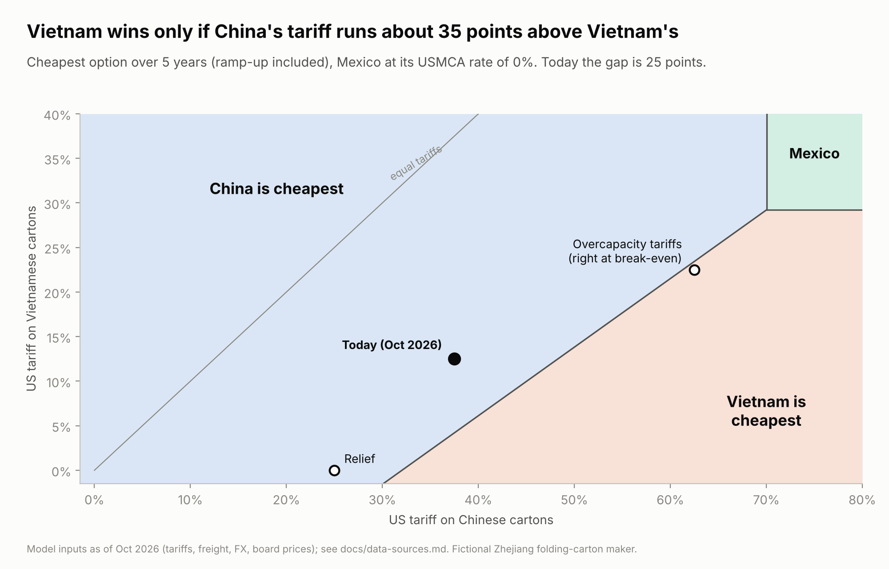
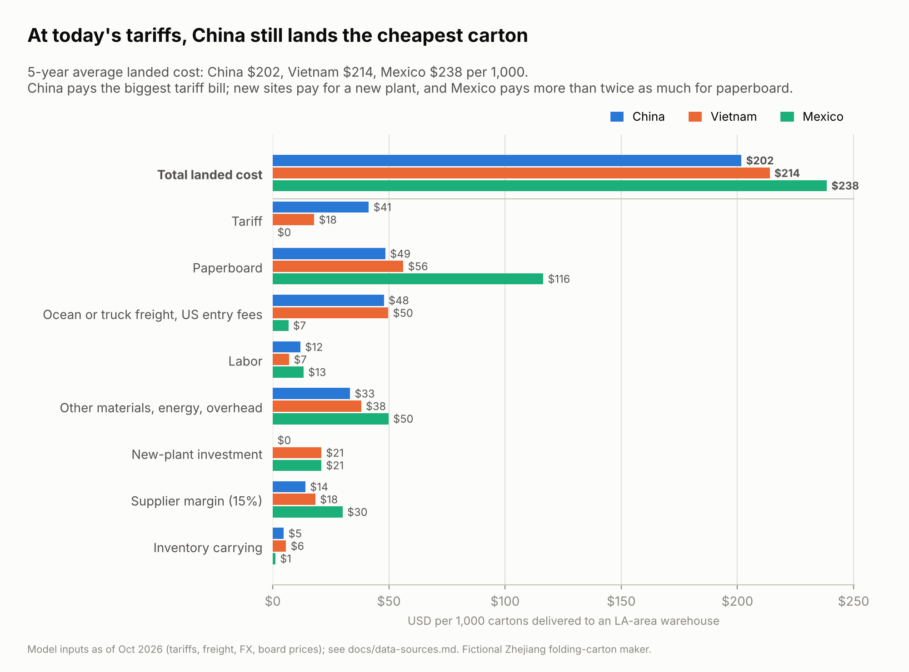
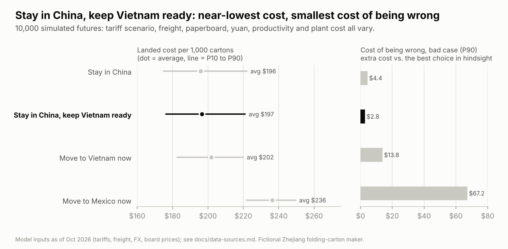
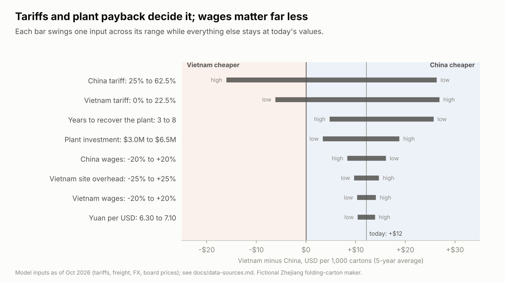

# 中国、越南还是墨西哥？关税时代的生产布局决策

[English](README.md) · **中文** · [交互式测算页面](https://hql7-luo.github.io/tariff-sourcing-decision/) · [一页决策备忘录（英文）](docs/memo.md)

一家浙江彩盒厂每年给一个美国客户供应 6,000 万个印刷折叠纸盒。2026 年 10 月，美国对中国纸盒的关税是 37.5%，越南是 12.5%，符合 USMCA 原产地规则的墨西哥纸盒免关税。这家工厂应该继续在中国生产，还是把美国订单转到越南或墨西哥？

项目用最新公开数据（关税、海运费、汇率、纸板价格、工资）搭了一个到岸成本模型，比较四种关税情景，并做了 10,000 次模拟。

## 结论

**现在先留在中国。花大约 30 万美元把越南方案准备好，等中国关税比越南高出约 35 个百分点时再转。**

| 5 年平均到岸成本（每千个纸盒） | 中国 | 越南 | 墨西哥 |
|---|---:|---:|---:|
| 按当前关税 | **$201.7** | $213.9 | $238.5 |
| 比中国贵 | | +$12.2（+6%） | +$36.7（+18%） |

- **越南的关税优势是真的，但还不够大。** 越南关税低，每千个纸盒省约 $24；但新工厂按 5 年回收，每千个要摊约 $21，再加上新厂的管理费用，就抵消了。
- **转移的触发点是中国关税到 48% 左右**（越南保持 12.5%）。美国正在进行的 Section 301“产能过剩”调查可能把关税推到这个位置：在这个情景下，越南已经略便宜（$228.6 对 $230.0）。
- **墨西哥输在纸板，不是工资。** 北美纸板价格约是中国的 2.3 倍；而且从 2026 年 7 月起，墨西哥对中国纸板征收最高 $0.49/公斤 的反倾销税，没法用便宜的中国纸板。墨西哥纸板到厂价要降到约 $910/吨（现在约 $1,250/吨）才能和中国持平。
- **不确定性下，“先等、但准备好”更稳。** 10,000 次模拟里，中国 78% 的情况下最便宜，越南 21%。准备越南方案平均只多花约 0.3%，但把较坏情况下“选错的代价”从每千个 $4.4 降到 $2.8。



## 主要图表

**成本从哪里来。** 中国关税最多；新工厂要回收投资；墨西哥的纸板成本是中国的两倍多。



**不确定性下的四种策略。** 每次模拟都会同时改变关税情景、运费、纸板价格、汇率、生产效率和建厂成本。



**什么会改变结论。** 关税和工厂回收期影响最大；工资和运费影响小得多，因为中国和越南都走海运。



## 模型怎么算

到岸成本 = 工厂成本（纸板、人工、能源、管理费用、新厂投资回收）+ 供应商利润 + 运费和美国清关费 + 关税（按报关价值计）+ 库存占用成本（在途和安全库存）。

- **四种策略：** 留在中国；现在转越南；现在转墨西哥；留在中国并准备越南（第 2 年看清关税走向后再决定）。
- **评估期 5 年**，折现率 10%。新工厂第一年效率低、废品多，并且要收回 500 万美元产线和 100 万美元启动成本。
- **四种关税情景**（概率是判断值）：维持现状 40%、关税缓和 20%、产能过剩关税 30%、USMCA 摩擦 10%。
- **蒙特卡洛模拟：** 10,000 次，8 个不确定输入按三角分布变化。

详细说明见 [methodology（英文）](docs/methodology.md)。

## 数据

所有输入都在 [`data/inputs.csv`](data/inputs.csv)，每一项都写了单位、来源、日期，并标注是**公开数据**还是**假设**。主要公开数据：

| 输入 | 数值 | 来源（日期） |
|---|---|---|
| 美国对中国折叠纸盒关税（HTS 4819.20） | 37.5% | Section 301 清单三 25% + 强迫劳动 Section 301 12.5%（2026年7月） |
| 美国对越南纸盒关税 | 12.5% | 强迫劳动 Section 301（2026年7月） |
| 美国对墨西哥纸盒关税 | 符合 USMCA 为 0% | USMCA 豁免（2026年7月） |
| 上海到洛杉矶海运费 | $7,884 / 40 尺柜 | Drewry WCI（2026年10月15日） |
| 中国白卡纸价格 | 4,040 元/吨（含税） | 生意社基准价（2026年10月8日） |
| 美国白卡纸价格 | $1,178/吨 | PackIndex 基准（2026年7月） |
| 墨西哥对中国纸板反倾销税 | $0.4854/公斤 | 墨西哥官方公报 DOF（2026年7月9日） |
| 汇率 | 6.69 元、25,639 越南盾、18.50 比索 / 美元 | 美联储 H.10、越南国家银行（2026年10月） |
| 工资 | 中国 76,055 元/年；越南 1,000 万越南盾/月；墨西哥综合 $5.50/小时 | 国家统计局 2025；越南统计局 2026 Q1；边境区基准 2026 |

完整来源和链接见 [docs/data-sources.md](docs/data-sources.md)。

## 运行

```bash
pip install -r requirements.txt
python run_analysis.py   # 生成 results/、figures/ 和交互页面的数据
pytest                   # 模型检查，包括 Python 和 JavaScript 结果一致
```

想换自己的假设，可以改 `data/inputs.csv` 或 `data/tariff_scenarios.csv` 再运行，也可以直接用[交互式测算页面](https://hql7-luo.github.io/tariff-sourcing-decision/)。

## 局限

- 公司是虚构的。工厂层面的数字（人工工时、管理费用、废品率、建厂投资）是假设，都已标注；真实决策要换成工厂自己的数据。
- 关税变化很快。强迫劳动 Section 301 关税正在被起诉，产能过剩调查还没结论，实际税率要和报关行确认。
- 模型只比较成本，不包括客户关系、质量风险、墨西哥交货快带来的库存以外的价值，以及当地税收优惠。
- “准备越南”这个策略假设第 2 年时关税走向已经清楚。

## 关于

罗浩绮（Haoqi Luo）的独立项目，华盛顿大学 Foster 商学院。我负责提出商业问题、确定范围，并审核假设和结论；AI 工具（Claude）在资料研究、代码和写作上提供了大量辅助。本项目不构成贸易、法律或投资建议。
